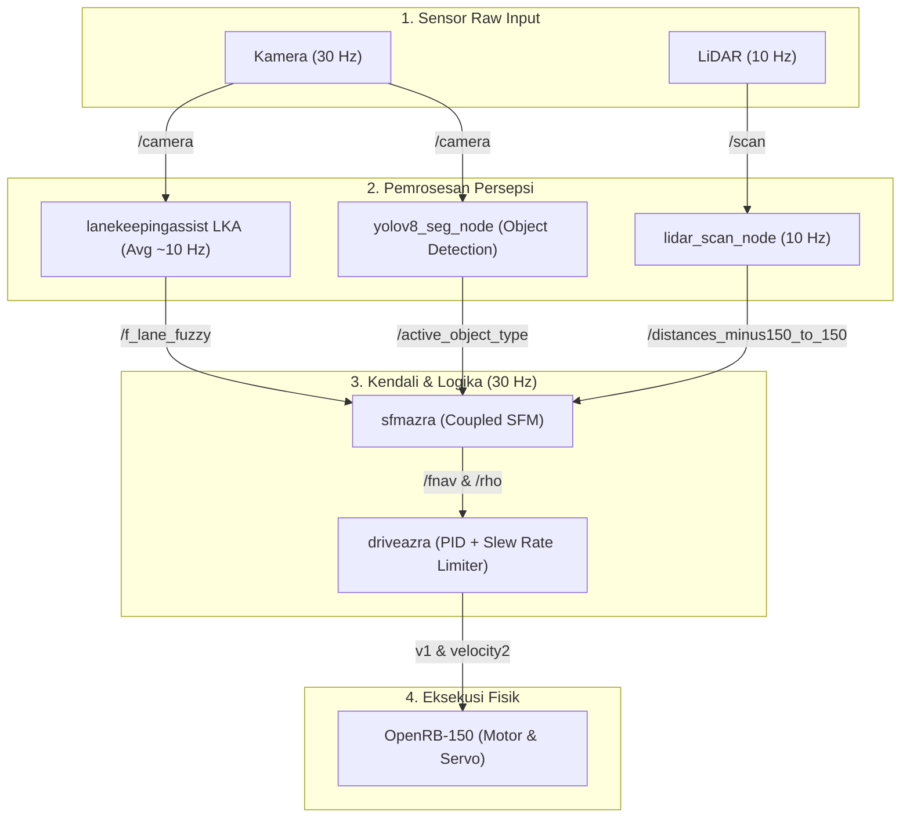

# Analisis Loop Sistem & Latensi Frame (ADAS Ackerman)

Dokumen ini berisi penjelasan teknis mengenai aliran data (*dataflow*), sinkronisasi sensor (*sensor fusion*), serta perhitungan jumlah frame yang diproses dalam satu siklus loop sistem ADAS pada prototipe robot Ackerman.

---

## 1. Arsitektur Aliran Data (Dataflow Diagram)

Sistem ini berjalan secara terdistribusi di dalam ekosistem ROS dengan komunikasi berbasis *Publish-Subscribe*. Berikut adalah visualisasi aliran data dari sensor hingga ke aktuator fisik:

---

## 2. Analisis Frame & Loop Temporal

Untuk menjawab pertanyaan mengenai *"berapa banyak frame yang diproses dalam satu loop"*, kita harus membaginya ke dalam 3 aspek analisis berikut:

### A. Aspek Aliran Data Logis (Logical Flow)
Secara logika pemrosesan, **kedua sensor utama diproses secara independen dan asinkron**:
* **Modul LKA** berlangganan langsung ke topik `/camera` ($30\text{ Hz}$). Namun karena bottleneck komputasi, ia memproses sekitar 10 frame gambar per detik.
* **Modul LiDAR Scan** berlangganan langsung ke topik `/scan` ($10\text{ Hz}$) untuk mendeteksi rintangan.
* **Logika Coupled SFM** menyatukan kedua data asinkron tersebut secara real-time pada loop rate $30\text{ Hz}$ untuk menerbitkan perintah kemudi ($\rho$) dan akselerasi/rem ($F_{\text{nav}}$).

### B. Aspek Sinkronisasi Waktu (Asymmetric Rates)
Sistem tidak menggunakan sinkronisasi waktu ketat (`time_sync_node` dinonaktifkan/tidak terpakai):
* **LKA (Kemudi)**: Berjalan rata-rata pada **$10\text{ Hz}$** (jarak perbarui $\approx 100\text{ ms}$).
* **LiDAR (Obstacle)**: Berjalan stabil pada **$10\text{ Hz}$** (jarak perbarui $\approx 100\text{ ms}$).
* **SFM Node (`sfmazra`)**: Berjalan pada loop tetap **$30\text{ Hz}$** ($33.3\text{ ms}$ per loop).
* **Kesimpulan**: Karena kedua data input diperbarui pada kecepatan $10\text{ Hz}$, SFM node ($30\text{ Hz}$) akan menggunakan data ter-cache selama 2 loop, dan memproses data baru pada loop ke-3.

---

## 3. Latensi Fisik Aktuator (Slew Rate Limiter Delay)

Setelah keputusan kemudi ($\rho$) dipublikasikan oleh SFM ke node `driveazra` ($30\text{ Hz}$), sistem tidak langsung mengubah posisi roda secara instan demi menjaga kestabilan mekanis robot. 

Node `driveazra` menerapkan **Slew Rate Limiter** sebesar **15 poin PWM per frame**:
* **Tengah/Lurus**: PWM $2050$
* **Batas Maksimum Belok**: PWM $2200$ (Selisih maksimum $\Delta = 150$ poin PWM)

Jika robot mendeteksi rintangan secara mendadak di sisi kiri dan harus membanting setir penuh ke kanan (perubahan $150$ poin PWM):
$$\text{Jumlah Frame Eksekusi} = \frac{150\text{ PWM}}{15\text{ PWM/frame}} = \mathbf{10\text{ frame}}$$

Pada frekuensi kontrol $30\text{ Hz}$, $10$ frame ini setara dengan **$333\text{ ms}$** waktu respons motor servo roda depan untuk mencapai posisi fisik target secara halus.

---

## 4. Ringkasan Latensi Per Node

| Komponen / Node | Frekuensi Input | Output Frame Rate | Deskripsi & Peran Latensi |
| :--- | :---: | :---: | :--- |
| **Sensor Raw Input** | - | Kamera: $30\text{ Hz}$ LiDAR: $10\text{ Hz}$ | Menangkap data mentah lingkungan fisik. |
| **Persepsi (`lanekeepingassist`)** | $30\text{ Hz}$ (Raw) | **$\approx 10\text{ Hz}$** | Memproses visi LKA secara langsung dari `/camera` ($100\text{ ms}$ per frame processing). |
| **Persepsi Lidar (`lidar_scan_node`)**| $10\text{ Hz}$ (Raw) | **$10\text{ Hz}$** | Memproses data jarak rintangan langsung dari `/scan`. |
| **Persepsi YOLO (`yolov8_seg_node`)** | $30\text{ Hz}$ (Raw) | **$\approx 10\text{ Hz}$** | Mendeteksi & mengklasifikasi tipe rintangan (dikirim ke `/active_object_type`). |
| **Decision Maker (`sfmazra`)** | $10\text{ Hz}$ | **$30\text{ Hz}$** | Menghitung vektor coupled SFM secara asinkron. Data baru diproses setiap **3 loop sekali**. |
| **Actuator Driver (`driveazra`)** | $30\text{ Hz}$ | **$30\text{ Hz}$** | Menerapkan *Slew Rate Limiter*. Butuh **$1$ s.d. $10$ frame** ($33 - 333\text{ ms}$) untuk eksekusi mekanik setir secara penuh. |

---

## 5. Analisis Kasus Khusus: Kecepatan Antrean (*Queue Size*) LKA

Pada pengujian aktual, modul `lanekeepingassist` diatur untuk berlangganan langsung ke topik `/camera` ($30\text{ Hz}$). Namun, data log menunjukkan frekuensi pemrosesan LKA efektif (`LKA Avg FPS`) stabil di kisaran **$10\text{ Hz}$** (dengan penurunan sesaat hingga **$5\text{ Hz}$** pada beban puncak).

### A. Penyebab Bottleneck Pemrosesan LKA ($10\text{ Hz}$)
1. **Queue Size = 1**: Untuk mencegah respon kemudi yang terlambat, ukuran antrean disubscribe sebesar `1`. Jika modul sedang sibuk memproses gambar, semua frame baru dari kamera akan langsung dibuang oleh ROS.
2. **Overhead Komputasi OpenCV**: Operasi pengolahan citra (HLS thresholding, Canny edge detection, HoughLinesP, dan fitLine) pada CPU *single-thread* Jetson Nano membutuhkan waktu komputasi yang intensif.
3. **Overhead Serialisasi Gambar ROS**: Di akhir pemrosesan, LKA mempublikasikan 2 gambar hasil debug: `/lka/output_image` ($\approx 921\text{ KB}$) dan `/lka/mask_image` ($\approx 307\text{ KB}$). Konversi menggunakan `cv_bridge` dan pengiriman data berukuran total $\approx 1.2\text{ MB}$ per frame membebani CPU, membatasi *refresh rate* LKA di kisaran $10\text{ Hz}$.

### B. Simulasi Pengaturan `queue_size = 0` (Infinite Queue)
Jika parameter `queue_size` diubah menjadi `0` pada node LKA, ROS akan menganggap antrean tidak terbatas. Hal ini akan berakibat fatal pada robot:

1. **Akumulasi Latensi Kemudi (Lag)**:
   Karena kecepatan produksi gambar ($30\text{ Hz}$) jauh lebih cepat daripada kecepatan pemrosesan ($10\text{ Hz}$), frame kamera akan terus menumpuk di antrean memori.
   * **Detik ke-1**: Terjadi penumpukan 20 frame (delay kemudi $\approx 660\text{ ms}$).
   * **Detik ke-5**: Terjadi penumpukan 100 frame (delay kemudi $\approx 3.3\text{ detik}$).
   * **Dampak**: Robot akan merespon belokan marka jalan yang sudah dilewatinya beberapa detik yang lalu, yang mengakibatkan kegagalan kendali (*crash* keluar lintasan).
   
2. **Kehabisan Memori RAM (OOM Crash)**:
   Menyimpan ratusan matriks gambar uncompressed ($640 \times 480$ BGR8) di memori RAM Jetson Nano (4GB) akan dengan cepat memicu *Out Of Memory (OOM) Killer* pada Linux, menyebabkan node LKA *crash* atau sistem membeku (*freeze*).

> [!TIP]
> **Kesimpulan Desain**:
> Pengaturan `queue_size = 1` adalah keputusan desain terbaik untuk sistem kontrol robotika *real-time*. Lebih baik membuang frame lama (*frame drop*) demi memastikan sistem selalu memproses gambar terbaru dan menghindari penumpukan latensi kemudi.

