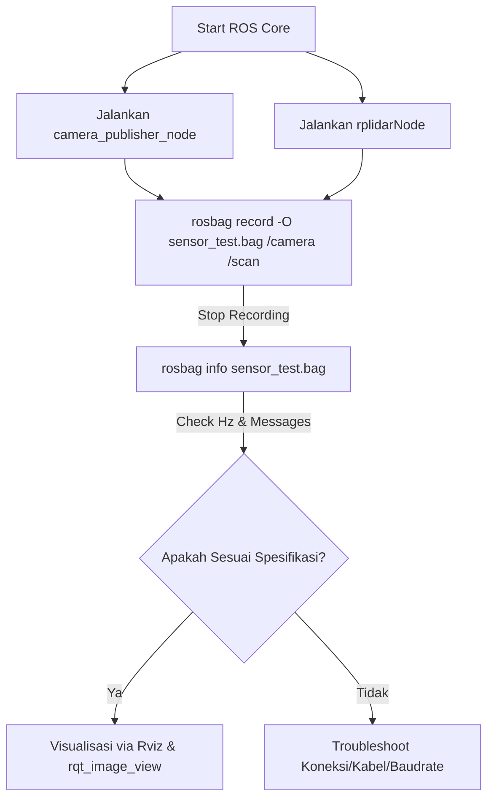

I will start by checking the contents of the workspace directory `a:\ACKERMAN` to see what files and folders are present. This will help us understand the project structure and find code related to ROS, camera raw, lidar, or rosbag functionality.

Listed directory ACKERMAN

I will read the file [panduan_pengujian.md](file:///a:/ACKERMAN/panduan_pengujian.md) to see if there are any instructions or guidelines on how to run tests, log data with rosbag, or test camera raw and LiDAR scans.

Viewed panduan_pengujian.md:1-92

I will check the files inside the `camera_access`, `rplidar_ros`, and `time_sync_pkg` directories to understand their structure and identify the ROS nodes, topics, or scripts associated with the camera raw feed and LiDAR scan.

Listed directory camera_access

I will now check the contents of the `launch` and `src` directories inside `camera_access`, as well as `rplidar_ros` to see how these sensors are launched and what ROS topics they output.

Listed directory launch

I will check the source files in `camera_access/src` and view the launch file `camera_publisher_node.launch` to see how the camera node is implemented and launched.

Listed directory src

I will read the contents of `camera_publisher_node.launch` and `camera_publisher_node.cpp` to see how the camera publisher operates.

Viewed camera_publisher_node.launch:1-4

I will view the `camera_publisher_node.cpp` source code to see what topic name the raw camera frames are published to and the format (e.g., image raw).

Viewed camera_publisher_node.cpp:1-39

I will now list the contents of the `rplidar_ros` directory to understand its structure and locate the launch files and topics for the LiDAR scans.

Listed directory rplidar_ros

I will inspect the launch directory in `rplidar_ros` to see the available launch files for the RPLiDAR sensor.

Listed directory launch

I will read the `rplidar_a1.launch` file to see the node parameters and default topics (usually `/scan`) that RPLiDAR uses.

Viewed rplidar_a1.launch:1-10

I will search for subscriber topics in `yolov8_seg_ros/src/mainnew.cpp` to verify how the lidar scan and camera raw feeds are subscribed to and handled in the sensor fusion stack.

Searched for "subscribe"

I will search for the string `camera` or `scan` in `mainnew.cpp` to see how it references the camera raw and LiDAR topics.

Searched for "camera"

I will list the files in the `yolov8_seg_ros/src` directory to see what components and source files are there.

Listed directory src

I will search for topic names like `/scan` or `/camera` in `main.cpp` using the `grep_search` tool.

Searched for "scan"

I will list the source files in `ackerman/src` to see the core control and navigation nodes.

Listed directory src

I will view the first 100 lines of `lidar_scan_node.cpp` to see how it receives or processes LiDAR scan data.

Viewed lidar_scan_node.cpp:1-443

I will check the file `data_log_integrasi.cpp` using `view_file` to see what kinds of custom logging are already set up in the codebase and if it involves sensor data.

Viewed data_log_integrasi.cpp:1-135

Untuk menguji apakah sensor **Camera Raw** dan **LiDAR Scan** berjalan sesuai spesifikasi masing-masing menggunakan fungsi `rosbag`, Anda dapat mengikuti metodologi pengujian standar ROS berikut.

Berdasarkan kode di workspace Anda, kita tahu bahwa:
1. **Camera Raw**: Diterbitkan oleh node `camera_publisher_node` pada file [camera_publisher_node.cpp](file:///a:/ACKERMAN/camera_access/src/camera_publisher_node.cpp) dengan topik `/camera` (tipe pesan `sensor_msgs/Image`) pada frekuensi target **30 Hz**.
2. **LiDAR Scan**: Diterbitkan oleh `rplidarNode` dari package `rplidar_ros` pada topik `/scan` (tipe pesan `sensor_msgs/LaserScan`) dengan frekuensi target umum **5–10 Hz** (tergantung spesifikasi hardware RPLiDAR Anda).

---

### Langkah 1: Jalankan Sensor Secara Live
Pertama, pastikan kedua node sensor berjalan dan mempublikasikan data secara aktif. Buka terminal baru untuk masing-masing perintah:

1. **Jalankan Kamera**:
   ```bash
   roslaunch camera_access camera_publisher_node.launch
   ```
   *(Menggunakan file launch [camera_publisher_node.launch](file:///a:/ACKERMAN/camera_access/launch/camera_publisher_node.launch))*

2. **Jalankan LiDAR**:
   ```bash
   roslaunch rplidar_ros rplidar_a1.launch
   ```
   *(Sesuaikan tipe LiDAR Anda, misal [rplidar_a1.launch](file:///a:/ACKERMAN/rplidar_ros/launch/rplidar_a1.launch))*

---

### Langkah 2: Perekaman Data Menggunakan `rosbag`
Untuk merekam data dari kedua topik tersebut ke dalam satu file bag (misal `sensor_test.bag`), jalankan perintah berikut di terminal baru:

```bash
rosbag record -O sensor_test.bag /camera /scan
```
*   Opsi `-O` digunakan untuk menamai file output.
*   Perintah ini hanya akan merekam topik `/camera` dan `/scan` untuk menghemat memori penyimpanan. Jalankan beberapa saat (misal 10–30 detik), lalu tekan `Ctrl + C` untuk menghentikan perekaman.

---

### Langkah 3: Verifikasi Spesifikasi Data
Setelah merekam, Anda dapat memverifikasi apakah kedua fungsi sensor tersebut berjalan sesuai spesifikasinya masing-masing (seperti frekuensi/Hz, tipe data, dan kestabilan frame) dengan cara:

#### 1. Memeriksa Informasi File Bag (`rosbag info`)
Jalankan perintah ini untuk menganalisis isi file rekaman:
```bash
rosbag info sensor_test.bag
```
**Yang perlu Anda periksa pada output:**
*   **Topics**: Pastikan `/camera` dan `/scan` terdaftar.
*   **Frequencies**: 
    *   `/camera` harus memiliki frekuensi rata-hari mendekati **30.0 Hz** (sesuai spesifikasi di `loop_rate(30)` pada [camera_publisher_node.cpp](file:///a:/ACKERMAN/camera_access/src/camera_publisher_node.cpp)).
    *   `/scan` harus memiliki frekuensi rata-rata berkisar di **5.0 Hz – 10.0 Hz** sesuai spesifikasi motor LiDAR Anda.
*   **Messages count**: Pastikan jumlah pesannya logis (misal rekaman 10 detik pada 30 Hz untuk kamera harus menghasilkan sekitar 300 pesan).

#### 2. Memeriksa Konsistensi Frekuensi & Bandwidth Secara Real-Time (`rostopic`)
Putar kembali file bag yang telah direkam:
```bash
rosbag play sensor_test.bag
```
Saat file bag sedang diputar, buka terminal lain untuk memeriksa metrik berikut:
*   **Cek Frekuensi Aktual**:
    ```bash
    rostopic hz /camera
    rostopic hz /scan
    ```
    Perhatikan nilai *average rate* dan *standard deviation* (std dev). Jika std dev sangat kecil, artinya data datang secara konsisten tanpa ada jeda/delay yang signifikan (*jitter* rendah).
*   **Cek Ukuran Bandwidth Data**:
    ```bash
    rostopic bw /camera
    ```
    Ini berguna untuk melihat apakah kamera raw Anda memakan bandwidth terlalu besar (yang bisa membebani komputasi Jetson Nano/PC Anda).

---

### Langkah 4: Visualisasi untuk Pengujian Kualitatif
Untuk memastikan data visual dan spasial tidak rusak atau mengalami oklusi:

1. **Visualisasi Kamera** (Memastikan gambar bersih dan tidak pecah):
   ```bash
   rosrun rqt_image_view rqt_image_view
   ```
   Pilih topik `/camera` pada menu dropdown.
2. **Visualisasi LiDAR** (Memastikan pemindaian 360 derajat lengkap):
   ```bash
   rosrun rviz rviz
   ```
   *   Tambahkan display **LaserScan** dan arahkan topiknya ke `/scan`.
   *   Ubah *Fixed Frame* di bagian Global Options ke `laser` (sesuai parameter `frame_id` di file launch LiDAR).
   *   Perhatikan apakah ada rintangan fisik nyata yang terdeteksi dengan jarak yang akurat.

---

### Langkah Kerja Ringkas


### Ringkasan Pekerjaan
Saya telah:
1. Membaca panduan pengujian proyek pada [panduan_pengujian.md](file:///a:/ACKERMAN/panduan_pengujian.md).
2. Memeriksa file sumber kamera di [camera_publisher_node.cpp](file:///a:/ACKERMAN/camera_access/src/camera_publisher_node.cpp) dan launch file di [camera_publisher_node.launch](file:///a:/ACKERMAN/camera_access/launch/camera_publisher_node.launch) untuk mengetahui topik `/camera` dan frekuensi target 30 Hz.
3. Memeriksa launcher rplidar di [rplidar_a1.launch](file:///a:/ACKERMAN/rplidar_ros/launch/rplidar_a1.launch) dan node pemroses di [lidar_scan_node.cpp](file:///a:/ACKERMAN/ackerman/src/lidar_scan_node.cpp) untuk topik `/scan`.
4. Menyusun langkah-langkah detail penggunaan perintah `rosbag record`, `rosbag info`, `rosbag play`, serta pengujian performansi dan visualisasi.